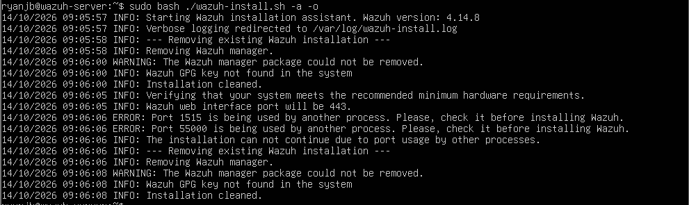
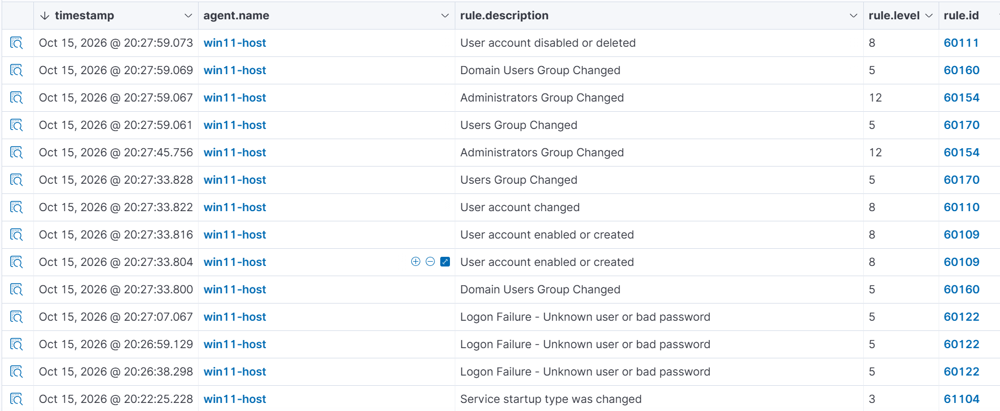
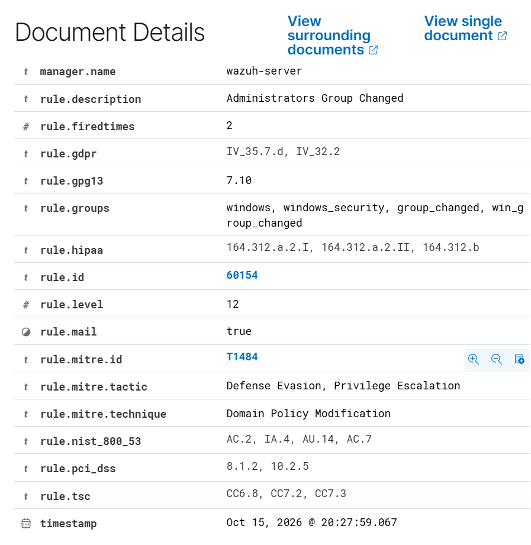
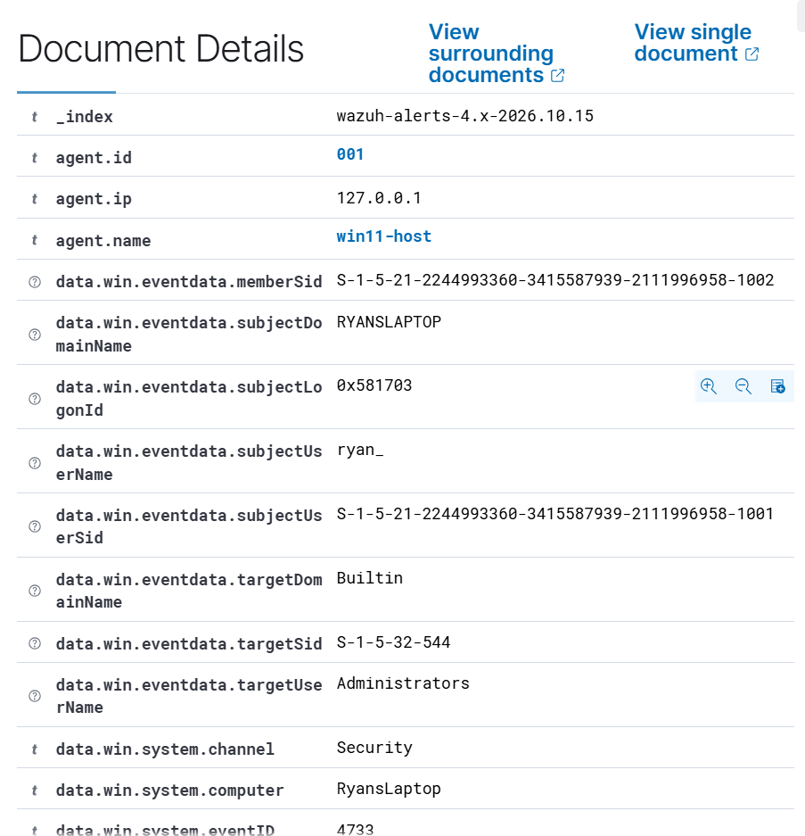

### Wazuh Home Lab: Windows Security Event Monitoring

A guided home lab exploring how Windows endpoint activity is collected, analysed and investigated using Wazuh.

I deployed an all-in-one Wazuh server in an Ubuntu virtual machine, connected my Windows laptop using the Wazuh agent, and generated controlled activity to test monitoring visibility. The exercises covered failed logons, account creation, local group membership changes and a PowerShell test that did not produce the expected alert.

### Objectives

- Build a working Wazuh monitoring environment.
- Connect a Windows endpoint and investigate its security events.
- Relate controlled actions to the evidence recorded in Wazuh.
- Examine event fields and matching detection rules.
- Document unsuccessful tests and visibility limitations alongside successful results.

### Lab Environment

| Component | Configuration |
|---|---|
| Physical host and monitored endpoint | Windows laptop |
| Virtualisation | Oracle VirtualBox |
| Server operating system | Ubuntu Server |
| Wazuh deployment | All-in-one server, version 4.14.8 |
| VM resources | 6 GB RAM, 4 virtual CPUs, 50 GB virtual disk |
| Endpoint collection | Wazuh agent on Windows |
| Investigation interface | Wazuh dashboard |

The Windows host also served as the monitored endpoint; it was not a separate disposable Windows VM. Testing was limited to controlled activity on my own system.

### Deployment and Troubleshooting

I installed Wazuh’s central components in the Ubuntu VM and connected the Windows endpoint through the Wazuh agent.

The installation required troubleshooting in several areas:

- **Storage allocation:** The virtual disk had sufficient allocated capacity, but Ubuntu’s root logical volume needed extending to make more of that space usable.
- **Port conflicts:** Processes left behind by a partial installation occupied ports `1515` and `55000`, preventing a subsequent installation attempt.
- **Package removal:** The remaining `wazuh-manager` package had broken removal scripts following the partial rollback. Clearing the damaged package state allowed installation to proceed.

*Figure 1: The Wazuh all-in-one installer halting due to active port collisions on 1515/55000 and incomplete package removal from a prior attempt.*

After resolving these issues, I confirmed that `wazuh-manager`, `wazuh-indexer`, `filebeat` and `wazuh-dashboard` were active.

I accessed the dashboard from Windows through VirtualBox NAT port forwarding, mapping host TCP port `8443` to guest TCP port `443`.

These steps reinforced the distinction between installing software, confirming that its services are running, and validating that useful endpoint data reaches the investigation interface.

### Security Monitoring Exercises

*Figure 2: Event stream in Wazuh dashboard showing captured logon failures, account creation, and group modifications from the Windows endpoint.*

#### 1. Failed Logons — Windows Event ID 4625

**Purpose:** Check whether controlled authentication failures could be investigated in Wazuh.

I generated failed-logon activity on the Windows endpoint and investigated the corresponding Windows security events in Wazuh.

**Result:** The exercise demonstrated visibility of the controlled failed-logon activity.

**Interpretation:** Event `4625` records a failed logon. It does not, by itself, establish a brute-force attack or malicious intent. The surrounding context is needed to distinguish ordinary authentication mistakes from suspicious behaviour.

#### 2. Account Creation — Windows Event ID 4720

**Purpose:** Examine monitoring visibility of local account-management activity.

I created a local test account and investigated the associated account-creation event.

**Result:** The account-creation test was documented against Windows Event ID `4720`.

**Interpretation:** An account-creation event establishes that an identity was created. Determining whether that action is concerning requires context, including who performed it and whether it was authorised.

#### 3. Local Group Membership Change — Windows Event ID 4733

**Purpose:** Investigate a change affecting local administrative group membership.

During cleanup, I examined an event recording removal of a member from the local Administrators group.

The verified result included:

- Windows Event ID `4733`.
- The local Administrators group as the affected group.
- Wazuh rule `60154`, with an alert level of `12`.
- A member SID rather than a resolved account name.

*Figure 3: Wazuh Rule 60154 trigger details (Level 12) mapped to MITRE ATT&CK T1484.*

*Figure 4: Windows Security Event 4733 log details preserving the member SID ending in -1002.*

**Result:** Wazuh surfaced the group-membership removal, allowing me to inspect the underlying event details.

**Interpretation:** This was an expected cleanup action, not evidence of privilege escalation. The alert level reflected the matching rule’s severity, not proof that a malicious incident had occurred.

The event also showed why identifiers such as SIDs remain useful when a readable account name is unavailable.

#### 4. Encoded PowerShell — Unresolved Visibility Gap

**Purpose:** Test whether an encoded PowerShell command produced the expected monitoring alert.

I ran an encoded PowerShell test, but the expected alert did not appear.

PowerShell Script Block Logging being disabled was identified as a possible explanation. However, I did not confirm the cause through a successful configuration change and retest.

**Result:** An unresolved visibility gap was documented.

**Interpretation:** No alert does not necessarily mean no activity occurred. Visibility depends on the endpoint generating the relevant logs, the agent collecting them, and the monitoring system processing them.

Encoding alone also does not establish that a PowerShell command is malicious.

### Results Summary

| Exercise | Recorded outcome |
|---|---|
| Failed-logon activity | Corresponding Event `4625` investigated in Wazuh |
| Local account creation | Account-creation test documented against Event `4720` |
| Administrators group cleanup | Event `4733` verified; Wazuh rule `60154` triggered |
| Encoded PowerShell | Expected alert absent; possible logging gap remained unconfirmed |

### Key Takeaways

- A running SIEM does not automatically provide complete endpoint visibility.
- Controlled tests help connect a known action with the evidence it generates.
- Event fields and context matter more than an alert title or severity alone.
- Account creation, group membership changes and authentication failures can be legitimate or suspicious depending on context.
- Unsuccessful tests are useful findings when their limitations are documented accurately.
- Installation troubleshooting and security-event investigation are distinct parts of building a monitoring lab.

### Scope and Limitations

This was a guided learning project using controlled activity, not a production deployment or an investigation of a real compromise.

The lab did not establish custom detection-rule development, successful brute-force detection, or a confirmed fix for the PowerShell visibility gap.

### Potential Follow-up Work

- Verify whether PowerShell Script Block Logging is enabled.
- Confirm collection of the relevant PowerShell event channel.
- Repeat the PowerShell test and document the outcome.
- Repeat the exercises on a separate Windows VM to make the test environment more disposable.
